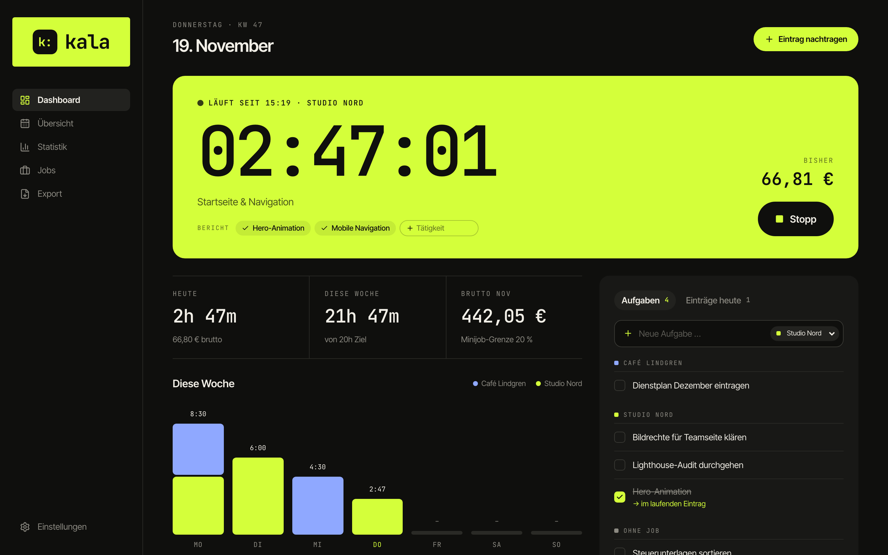

# kala

Zeiterfassung für Nebenjobs, Minijobs und Freelance-Stunden. Du startest einen Timer,
kala rechnet mit deinem Stundenlohn mit und zeigt, was diese Woche und diesen Monat
brutto zusammenkommt. Selbst gehostet, für eine Person, im Browser oder als
installierte App auf dem Handy.



## Funktionen

- **Timer und Nachträge.** Ein Klick startet die Zeit für einen Job. Vergessene
  Einträge trägst du mit Start, Ende und Notiz nach.
- **Runden beim Stoppen.** Beim Stoppen schlägt kala die auf ¼, ½ oder 1 Stunde
  gerundete Zeit vor, ab- und aufgerundet mit dem jeweiligen Betrag. Den Schritt legst
  du in den Einstellungen fest.
- **Tätigkeitsbericht.** Jeder Eintrag sammelt, was du gemacht hast. Hakst du eine
  Aufgabe ab, landet sie im laufenden Eintrag.
- **Aufgaben pro Job.** Eine kleine To-do-Liste neben dem Timer, nach Job gruppiert
  und direkt in der Liste bearbeitbar.
- **Mehrere Jobs mit Lohnverlauf.** Ändert sich dein Stundenlohn, gilt der neue Satz
  ab dem Stichtag. Ältere Einträge behalten den Lohn, der damals galt.
- **Minijob-Grenze.** Für Minijobs zeigt das Dashboard, wie viel der monatlichen
  Verdienstgrenze (603 €, Stand 2026) schon erreicht ist.
- **Wochenübersicht und Statistik.** Stunden pro Tag und Job, Brutto pro Job,
  Fortschritt gegen dein Wochenziel.
- **Export.** Beliebige Zeiträume als CSV oder PDF, etwa als Stundennachweis.
- **Live auf allen Geräten.** Startest du den Timer am Handy, aktualisiert sich der
  offene Tab am Laptop sofort.
- **Installierbar.** Als PWA zum Homescreen hinzufügen.

Die Oberfläche ist auf Deutsch.

## Selbst hosten

Du brauchst einen Server mit Docker und Docker Compose. Die App läuft in einem
Container, Postgres in einem zweiten. Datenbank-Migrationen laufen bei jedem Start
automatisch.

```sh
git clone <repo-url> kala && cd kala
cp docker/.env.example docker/.env
```

In `docker/.env` mindestens diese beiden Werte setzen:

| Variable            | Bedeutung                                                              |
| ------------------- | ---------------------------------------------------------------------- |
| `POSTGRES_PASSWORD` | Passwort der Datenbank                                                 |
| `ORIGIN`            | Die Adresse, unter der du kala öffnest, z. B. `http://homeserver:3000` |

`ORIGIN` muss exakt stimmen, mit Protokoll und Port. Sonst lehnt SvelteKit jedes
Formular als Cross-Site-Request ab und nichts wird gespeichert. Hinter einem
HTTPS-Reverse-Proxy gehört dort die öffentliche `https://`-Adresse hin.

Dann starten:

```sh
docker compose -f docker/compose.yaml up -d --build
```

kala läuft danach auf Port 3000 (änderbar über `KALA_PORT`). Für ein Update `git pull`
und denselben Befehl noch einmal ausführen.

> [!WARNING]
> kala hat keinen Login. Mach die App nicht im Internet erreichbar, sondern nur im
> Heimnetz oder über ein VPN wie Tailscale.

### Backup

```sh
docker compose -f docker/compose.yaml exec db pg_dump -U kala kala > kala-backup.sql
```

`kala` steht hier für `POSTGRES_USER` und `POSTGRES_DB` aus der `.env`.

## Entwicklung

Benötigt Node 24 oder neuer und Docker für die lokale Datenbank.

```sh
cp .env.example .env
npm install
docker compose up -d      # Postgres auf localhost:5432
npm run db:migrate
npm run dev               # http://localhost:5173
```

Mit [just](https://github.com/casey/just) erledigt `just dev` die letzten drei Schritte
auf einmal.

| Befehl                | Zweck                                         |
| --------------------- | --------------------------------------------- |
| `npm run check`       | Typprüfung mit svelte-check                   |
| `npm run lint`        | Formatierung prüfen (Prettier)                |
| `npm run db:generate` | Migration aus Änderungen an `schema.ts` bauen |
| `npm run db:migrate`  | Ausstehende Migrationen anwenden              |
| `npm run db:studio`   | Datenbank im Browser ansehen (Drizzle Studio) |

`npm run db:push` nicht verwenden. Schemaänderungen laufen immer über `db:generate`
und `db:migrate`, damit die Migrationen im Repo landen.

## Technik

- [SvelteKit](https://svelte.dev/docs/kit) mit Svelte 5 und TypeScript, ausgeliefert
  über `adapter-node`
- [Tailwind CSS v4](https://tailwindcss.com)
- Postgres 17 mit [Drizzle ORM](https://orm.drizzle.team)
- Live-Updates über Postgres `LISTEN`/`NOTIFY` und Server-Sent Events
- PDF-Export mit [PDFKit](https://pdfkit.org)

Ein paar Regeln im Code:

- Geld wird in ganzen Cent gespeichert, nie als Kommazahl.
- Alle Änderungen laufen über SvelteKit-Form-Actions. Eigene API-Routen gibt es nur
  für CSV, PDF und den Event-Stream.
- Datenbankzugriffe liegen gesammelt in `src/lib/server/db/queries.ts`.

Architektur und Ausbaustufen beschreibt [docs/roadmap.md](docs/roadmap.md). Als
Nächstes geplant ist eine vereinfachte Brutto-Netto-Rechnung.
